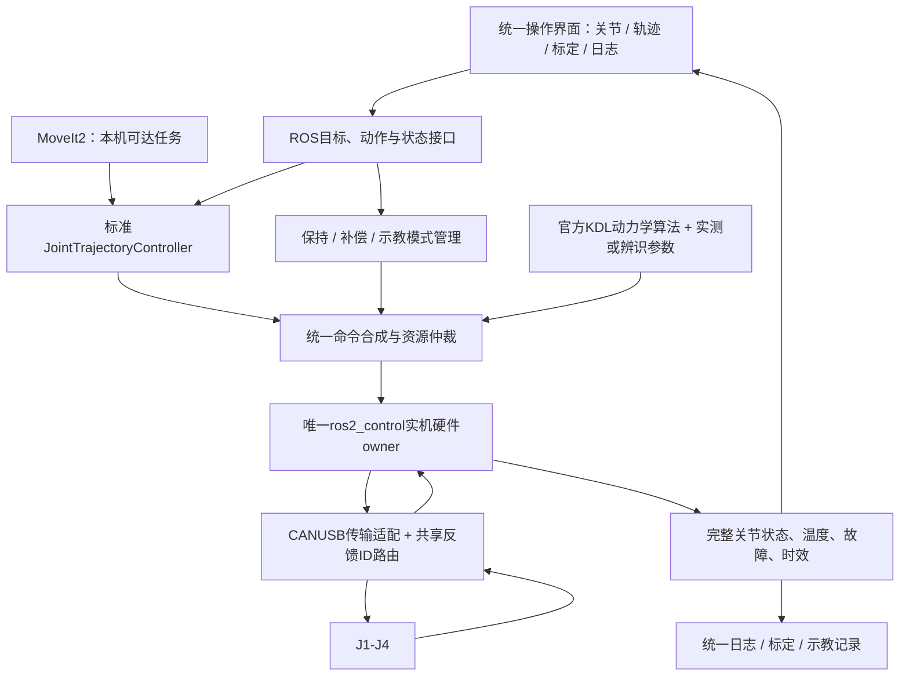

# SLAI整臂控制重整方案（2026-11-02）

2026-11-04 更新：用户明确选用原 COM9/921600 的 CANUSB。第 0 步坐标统一已完成；CANUSB 的 ROS 只读插件、报文层与启动配置已实现并通过离线/虚拟串口验证，尚未实机接入。详见 `verification/hardware/canusb_ros_readonly_20261104/CANUSB只读接入说明.md`。以下早期“尚未实现”表述是 11 月 2 日基线，不应作为当前软件清单。

目标恢复为：尽量复用OpenArm成熟组件，让本机整臂具备统一关节控制、协调轨迹、真实负载补偿、适配自由度的末端控制，以及示教记录/回放。J1–J4为当前实施对象，J5保留扩展接口，在模型、方向、零位未明确前不查询、不使能、不控制。

这份文件是经过源码核查后的架构决策和交付边界，不是“完整控制已经实现”的交付证明。本轮只读审计、整理方案，没有操作实机或继续修改积分参数。

## 先纠正当前状态

此前把“复用OpenArm MIT编码”与“完整OpenArm控制适配”讲得过近，导致交付预期错误。现状是两条没有贯通的链路：

- ROS 2侧：已有四轴描述、标准关节轨迹控制器和OpenArm编码器链接，但硬件插件仅接受fake，反馈由软件位置跟随生成。
- Windows实机侧：CANUSB串口收发、参数快照、方向/零位映射、局部原生MIT运动、独立采集和故障日志。不是完整ROS整臂硬件接口，也没有形成四轴协调控制及重力模型闭环。

J3/J4的单轴往返等证据保留其原有范围。离线测试数量不代表实机整臂验收，自动采集和有界积分不代表已完成重力辨识。最新J1方向为+1，2026-11-01的零位不变；J1旧方向表、模型扇区和用户实测扇区有差异，不能让多个入口各自解释。

本地源码依据：[fake初始化限制](D:/CodexData/Projects/机械臂/slaihand_ros2_ws/src/slaihand_hardware/src/openarm_joint_fake.cpp:17)、[假反馈与零增益编码](D:/CodexData/Projects/机械臂/slaihand_ros2_ws/src/slaihand_hardware/src/openarm_joint_fake.cpp:104)、[现有标准轨迹控制器配置](D:/CodexData/Projects/机械臂/slaihand_ros2_ws/src/slaihand_bringup/config/slaihand_controllers.yaml)、[最新映射](D:/CodexData/Projects/机械臂/slaihand_ros2_ws/src/slaihand_bringup/config/hardware_mapping.yaml)、[J1方向修正](D:/CodexData/Projects/机械臂/slaihand_ros2_ws/outputs/标定记录_20261102/修正_J1方向_20261102.md)。

## 采用一条主线

选择ROS 2 / ros2_control作为整臂主控制链路，复用OpenArm真实硬件接口的结构和标准控制器；现有Windows界面作为上层操作端。物理串口只由硬件owner持有。WSL或原生Linux的USB设备接入、权限及持续性能需要验证；不能假设Windows的COM9已经等于Linux的can0。

图中的“统一命令合成”必须落实控制接口资源归属：不能让轨迹控制器和另一个effort控制器无仲裁地抢同一关节，也不能把两个完整MIT命令相加。先确认所选标准控制器版本支持的命令接口组合；重力计算通过一个明确接口合入最终tau_ff。位置、速度、前馈和增益的责任必须唯一。

## 完整复用矩阵

| 层 | 采用什么 | 本机必须完成的适配 | 当前能否宣称完成 |
|---|---|---|---|
| 电机协议 | 官方MIT编解码、状态语义 | 实测PMAX/VMAX/TMAX、ID、方向和零偏 | 局部实机证据；不是整臂适配完成 |
| 传输/分轴 | 复用本机已验证CANUSB帧格式 | 串口后端、独占、超时、ID0反馈按payload分轴 | Python链路存在；ROS实机接线未完成 |
| 实机硬件接口 | OpenArmHW / ros2_control生命周期 | 4轴配置、真实q/dq/effort、诊断、受控激活/停止 | 当前ROS插件只有fake |
| 关节和轨迹 | 标准状态广播、JointTrajectoryController | 四轴列表、命令接口组合、周期与容差 | fake通过；实机统一链路未验收 |
| 重力/动力学 | 官方teleop里的Orocos KDL计算 | 本机几何、安装方向、真实或辨识参数、映射 | 算法已查到，本机参数与集成未完成 |
| 自动采集/辨识 | 复用现有日志和稳定窗口 | 四轴实际保持资格、姿态覆盖、摩擦区分、拟合/留出验证 | 只是采集候选，不是可部署补偿模型 |
| 末端控制 | MoveIt2及成熟FK/IK | 本机SRDF、碰撞模型、限位与4DOF任务定义 | 当前没有本机完整规划链路 |
| 示教/回放 | 标准状态/轨迹接口；按需接官方ROS桥 | 时间轴、保存格式、回放预览、可达性和执行验收 | 不把“能记录”写成“拖动示教回放完成” |
| 用户界面 | 原六页框架作为统一入口 | 所有控制都通过同一owner；标定是模式而非另一条私有发包链 | 多入口分散，尚待收敛 |

四轴本体不能普遍实现七轴机械臂的任意6D末端位姿目标。首期末端验收应定义可达位置/有限姿态任务；J5日后加入也需重新定义任务空间，不能用界面功能相似掩盖自由度差异。

## 两个必须先解决的真实接入问题

1. **CANUSB不是SocketCAN的一个配置名称。** 官方CANSocket具体耦合Linux接口，本机使用串口封装。需要有边界的传输与调度适配，保留官方编解码和成熟上层。未核实CANUSB支持SLCAN，不能直接推荐slcand；也不先要求购买新适配器。
2. **四轴反馈都在CAN ID 0。** 官方设备集合按recv CAN ID作为map键，直接注册四个0会覆盖。本机必须先分帧，再区分寄存器回复和运动反馈，并按已验证payload轴号更新各轴独立状态、故障和时间戳。不能为迁就上游键结构擅自改电机master ID。

上游原始OpenArmHW还会激活使能并自动回零，且默认7轴及固定ID/型号。这些必须适配为本机四轴白名单、有效新鲜反馈接管和显式动作；原样launch不是可接受的捷径。

## 重力补偿回到正确位置

官方确有重力运行实现：`openarm_teleop/control/gravity_compasation.cpp`调用KDL动力学，发送tau前馈。其数学计算应复用；它自身也是总线owner，不能与ROS硬件驱动同时运行。

本机明确不使用仿真暂估重量产生实机力矩，也不照搬OpenArm官方机械结构的惯性参数。可用参数来源是实测质量/质心/安装方向，或有可观测性检查和留出验证的实机参数辨识。几何模型可用于构建辨识回归量，不能把未知质量填成默认值后宣称标定完成。

采集记录完整q1…q4、dq1…dq4、控制模式、使能状态、驱动反馈估计、实际发送命令及时间。只有实际参与保持且有稳定窗口的轴，其力矩才能成为保持输入样本；失能轴读数、运动中的惯性项、托架分担载荷都不能直接当重力真值。正反向同姿态数据可帮助观察摩擦差异，不能无条件声称平均后就是纯重力。

有界积分可作为特定控制模式的误差修正，不能继续充当完整重力补偿方案，更不能凭一次局部采样宣布全臂标定完成。参数尚不可信时，四轴协调位置/轨迹链路仍应先完成，重力补偿明确标为未启用。

## 保留与停止扩展

- 保留：原始日志、已验证串口帧/解码、实机映射、参数读取、停止确认、单轴实机证据、四轴描述、现有标准轨迹控制器和UI设计。
- 重用为诊断：单轴窗口、保持采样、自动采集原型。保留源码和证据，但暂不让用户继续大范围扫描作为主线推进。
- 停止新增：更多独立发包窗口、分散的使能/停止状态机、在单轴工具中继续堆整臂规划与补偿逻辑。
- 不直接使用：fake位置回填当真实反馈、仿真暂估惯性当实机参数、官方7轴默认映射/自动回零、多个driver同时持有总线。

## 按整臂结果验收

| 里程碑 | 必须交付 | 通过证据 |
|---|---|---|
| A：统一实机状态链路 | CANUSB后端接入真实ROS硬件接口；单一配置/owner | ROS中四轴q/dq/effort与原始帧一致、各轴新鲜度可查；只读阶段0运动/0参数写入 |
| B：四轴协调关节控制 | 四轴当前位置接管、标准整臂轨迹、统一异常处理 | 实机4轴共同时间轴、实测周期/发送偏差/丢帧、实际误差和停止结果；不是fake通过 |
| C：真实补偿 | 经验证参数和KDL计算接入同一控制周期 | 同姿态/轨迹开关补偿对比、留出姿态误差、实机负载条件和参数版本齐全 |
| D：末端任务与示教 | 本机MoveIt可达任务、轨迹记录/预览/回放 | 本机实物末端结果；记录、规划成功和实际执行成功分别证明 |

控制频率按四轴CANUSB实测确定，现有100Hz只是配置目标；不照抄官方750Hz，也不把共用时间轴说成CAN报文物理同时发送。命令提交、串口写入、驱动状态观察和目标到达分别记录，不能将写入成功当作逐帧执行确认。

第一项工程工作固定为**CANUSB传输/反馈路由适配＋真实四轴ros2_control状态接口**。先让现有标准ROS轨迹主链与真实硬件贯通，再增加功能，不再用另一个单轴工具代替这个交付。

本轮尚未实现该硬件适配、未编译新的完整上游组合、未做新的实机测试。上游审计版本只是核查快照，不是已验证兼容的整套发行版；下一步需固定最小依赖、构建并做帧回放验证。

## 官方源码依据

详见[官方完整链路核查](D:/CodexData/Projects/机械臂/slaihand_ros2_ws/verification/hardware/openarm_full_stack_20261102/官方完整链路核查.md)，含各仓固定提交和实际运行路径。

- [OpenArmHW](https://github.com/enactic/openarm_ros2/blob/8f23aeabb372c256f7807b9a74d48e035fc68386/openarm_hardware/src/openarm_simple_hardware.cpp)：真实状态/命令接口与激活行为。
- [KDL动力学](https://github.com/enactic/openarm_teleop/blob/eb2d49338bf70ace95282ea724903849397b7811/src/controller/dynamics.cpp)：实际重力、FK/Jacobian等计算。
- [gravity_comp主循环](https://github.com/enactic/openarm_teleop/blob/eb2d49338bf70ace95282ea724903849397b7811/control/gravity_compasation.cpp)：真实前馈执行路径。
- [CAN设备集合](https://github.com/enactic/openarm_can/blob/f3ca25bbda1e239f4cc81f4563fbc75538fef874/src/openarm/canbus/can_device_collection.cpp)：共享recv ID路由问题。
- [CANSocket耦合](https://github.com/enactic/openarm_can/blob/f3ca25bbda1e239f4cc81f4563fbc75538fef874/src/openarm/damiao_motor/dm_motor_device_collection.cpp)：传输适配不是改一项配置。
